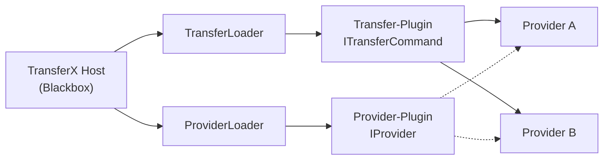

# Plugin-Architektur

<!-- Plugin-Sicht (Host als Blackbox). Gesamt-TransferX-Architektur liegt in der TransferX-Produktdokumentation. -->

Dieses Dokument beschreibt die Architektur **aus Sicht eines Plugin-Entwicklers**.  
Der TransferX-Host erscheint nur als Blackbox: er lädt Plugins, initialisiert Provider und führt Transfer-Commands aus.

Basis: [Abstractions](abstractions.md), [Plugin-Lifecycle](plugin-lifecycle.md), [Versionierung](../conventions/versioning.md).

## Übersicht

| Rolle | Verantwortung |
|-------|----------------|
| **Host** | Lädt Assemblies, hält Konfiguration, startet Transfers, aggregiert Fortschritt |
| **Provider-Plugin** | Zugriff auf eine Datenquelle/-senke über `IProvider` |
| **Transfer-Plugin** | Transfer-Logik zwischen zwei Providern über `ITransferCommand` |

Plugins referenzieren **nur** die öffentlichen SDK-Pakete (`TransferX.Domain`, `TransferX.Provider.Abstractions`, `TransferX.Transfer.Abstractions`).  
Eine Referenz auf `TransferX.Core` ist nicht erlaubt und bricht den Build ab.

## Grenzen

**Im Plugin**

- Metadata-Attribute (`[ProviderMetadata]`, `[TransferMetadata]`)
- Implementierung der Abstractions-Interfaces
- Requests/Responses bzw. Transfer-Modelle laut Contracts
- Fortschritt über die vom Host übergebenen Progress-APIs

**Nicht im Plugin**

- Host-DI, Datenbank, API-Controller, UI
- Direkte Abhängigkeit von Application-/Infrastructure-Schichten
- Instanziierung von Host-internen Typen (z. B. ProgressAggregator – erzeugt der Host)

## Discovery und Ausführung

1. Host scannt Plugin-Verzeichnisse (`ProviderLoader` / `TransferLoader`).
2. Reflection findet Metadata-Attribut + Interface + geeigneten Konstruktor.
3. Provider: `InitializeAsync`, danach Commands/Queries über `ExecuteAsync`.
4. Transfer: `ExecuteAsync` mit Quelle/Ziel-Providern und `TransferContext`.

Details: [Plugin-Lifecycle](plugin-lifecycle.md), How-tos unter [Provider](../providers/implement-provider-plugin.md) und [Transfer](../transfers/implement-transfer-plugin.md).

## Verträge und Versionen

- Provider: [Provider Contracts](../../sdk/contracts/provider-contracts.md)
- Transfer: [Transfer Contracts](../../sdk/contracts/transfer-contracts.md)
- Kanonische NuGet-Version: [sdk/package-versions.json](../../sdk/package-versions.json)
- SemVer / Major-Alignment: [Versionierung](../conventions/versioning.md)

## Weiterführend

- [Abstractions](abstractions.md) – Interfaces und Modelle
- [Provider-Authentifizierung](../providers/authentication.md)
- Templates und Beispiele: https://github.com/SOWITransferX/plugin-devkit
